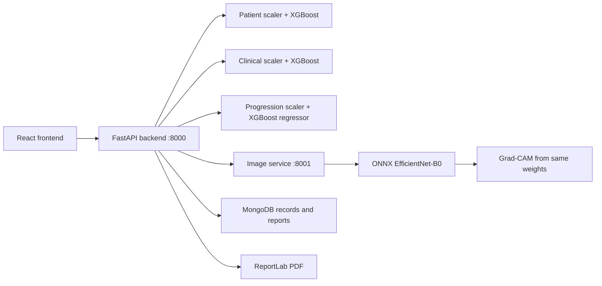

# Vision AI: ML, DL, and explainability presentation guide

## 1. What the project actually does

Vision AI is a screening and decision-support prototype with four deployed prediction models. It uses tabular models for lifestyle and clinical measurements, and an image classifier for pathologic myopia. The outputs are presented together; there is no trained multimodal fusion model combining them into a single diagnosis.

| Model | Algorithm | Input | Output | Live artifact |
|---|---|---|---|---|
| Patient screening | XGBoost binary classifier | 7 lifestyle/demographic features | Myopia probability | `backend/models/detection_patient.pkl` |
| Doctor assessment | XGBoost binary classifier | 13 lifestyle/biometry features | Myopia probability | `backend/models/detection_doctor.pkl` |
| Progression | XGBoost regressor | 7 features | Estimated next SPHEQ, in diopters | `backend/models/progression_model.pkl` |
| Fundus classification | EfficientNet-B0 | Preprocessed retinal image | PM or Non-PM and class probabilities | `ml/checkpoints/palm_efficientnet_b0.onnx` |

Each tabular model has a corresponding saved StandardScaler. Grad-CAM explains the image classifier; it is not a fifth trained model. `fundus_cnn.pth`, `detection_model.pkl`, and `scaler.pkl` are legacy artifacts, not the active prediction paths above.

## 2. Architecture and request flow



The patient simulator calls `/patient/preview`, which runs the same patient model without saving a screening or sending an email. Doctor uploads go to `/doctor/upload-image`; `/doctor/predict` calls the clinical models and, when an image is provided, the image service. The image service receives `explain=true` and returns a prediction plus Grad-CAM images. The report stores the explanation and current/model-predicted SPHEQ.

## 3. ML fundamentals and why XGBoost is used

ML uses examples to fit parameters rather than prescribing a hand-written scoring formula. Classification predicts a category or its probability; regression predicts a continuous quantity. XGBoost adds decision trees sequentially to optimize an objective, with regularization to control complexity. It suits the structured numeric feature tables used here. See the [original XGBoost paper](https://arxiv.org/abs/1603.02754).

Simplified representation: `score(x) = sum of tree outputs`; the binary classifier transforms its score into a probability. The regressor produces a numeric output. The saved models use `binary:logistic` and `reg:squarederror`, respectively.

### Patient model: exact input order

1. `age`
2. `gender_idx`: female = 1, other strings currently map to 0; this binary encoding is a limitation.
3. `reading_hours` (API accepts `reading_time`)
4. `screen_time`
5. `outdoor_activity`
6. `sleep_hours`
7. `parental_myopia`: 0, 1, or 2 parents

The form also collects name, work hours, and optional biometry, but those are not features of the deployed patient classifier. Do not tell the panel that work hours directly changes this model's prediction.

### Doctor model: exact input order

The same seven inputs, followed by `al`, `acd`, `lt`, `vcd`, `spheq`, and `visit_year`.

| Abbreviation | Meaning | Input unit |
|---|---|---|
| AL | Axial length | mm |
| ACD | Anterior chamber depth | mm |
| LT | Lens thickness | mm |
| VCD | Vitreous chamber depth | mm |
| SPHEQ | Spherical equivalent refraction | diopters |

The API uses `axial_length` for AL and `refractive_error` for SPHEQ. Missing optional lifestyle inputs are supplemented from the stored patient. The service currently has fixed defaults for remaining missing clinical fields; these are input imputations, not extra measured findings, and should be disclosed during demonstrations.

### Progression model: exact input order

`age, gender_idx, spheq, al, reading_hours, screen_time, outdoor_activity`.

Its output is next-SPHEQ. The displayed progression category is calculated from `predicted_next_spheq - current_spheq`: below -0.75 is High, below -0.25 is Normal, otherwise Low. These are application thresholds, not three separately learned classes. The visit interval is not modeled; do not describe the output as a validated annual progression rate.

### Actual saved hyperparameters

These values were inspected from the artifacts, rather than copied from training-script defaults.

| Parameter | Patient | Doctor | Progression |
|---|---:|---:|---:|
| Number of trees | 300 | 400 | 300 |
| Maximum depth | 4 | 4 | 4 |
| Learning rate | 0.05 | 0.10 | 0.05 |
| Row subsample | 0.9 | 0.9 | 0.8 |
| Column subsample | 0.7 | 0.9 | default |
| Minimum child weight | 1 | 5 | default |
| Gamma | 0 | 0.3 | default |
| L1 regularization | 0.05 | 0.1 | default |
| L2 regularization | 1 | 2 | default |
| Random seed | 42 | 42 | 42 |

Runtime versions are pinned to scikit-learn 1.8.0 and XGBoost 3.2.0 to match the serialized artifacts.

### Scaling and probability interpretation

StandardScaler applies `z = (x - training_mean) / training_standard_deviation`. Although tree models do not generally require standardization, these artifacts were trained with it, so inference must apply the corresponding saved scaler in the correct feature order.

The classifier's positive-class probability is mapped to Low below 0.40, Medium/Moderate from 0.40 to below 0.70, and High from 0.70 upward. The patient binary flag uses 0.50. Thus a Medium category can occur on either side of the binary decision threshold. These are presentation thresholds over learned scores; they are not a substitute rule-based predictor.

The legacy JSON field `confidence` in the clinical report means probability of myopia, not confidence in the displayed Low/Moderate/High category. For example, 1% with Low is consistent. The UI now labels it “Myopia probability.” Recommendations are authored text selected from that category, not generated clinical knowledge from XGBoost.

## 4. Tabular datasets and evaluation limitations

The bundled `balanced_dataset.csv` contains 5,000 rows (2,500 in each class). `balanced_dataset_v2.csv` contains 5,400 rows (2,706 positive and 2,694 negative). Both have 22 columns. Rows must not be described as that many independently recruited patients without provenance evidence.

`retrain_balanced.py` generates healthy and borderline examples and uses SMOTE. Its progression target is generated by subtracting sampled changes from current SPHEQ: 0.1–0.6 for positive rows and 0–0.08 for negative rows. The deployed regressor is therefore an experimental model, not established evidence of real longitudinal forecasting. The exact source dataset/training-run provenance of each artifact is not fully recorded.

The historical tabular evaluation scripts also contain evaluation leakage risks: scaling before fold splitting; SMOTE before some CV operations; and, in some paths, selecting hyperparameters before reporting a hold-out split. High scores from those scripts are not reliable external validation. A valid future experiment should split independent patients first, put preprocessing and resampling inside each training fold, tune only within training data, and evaluate the untouched hold-out once. No independently verified ML accuracy is claimed in this guide.

## 5. Deep learning model

The code builds torchvision EfficientNet-B0 from ImageNet weights, replaces its classifier with Dropout(0.4) and Linear(1280, 2), and exports the trained model to ONNX. EfficientNet is a convolutional model family designed around balancing depth, width, and input resolution. See the [original EfficientNet paper](https://proceedings.mlr.press/v97/tan19a.html).

For this project the spatial input is 224 × 224 RGB. The final spatial feature tensor is `1 × 1280 × 7 × 7`. Global average pooling reduces it to 1,280 features, and the linear classifier produces two logits. Softmax converts logits into class probabilities. The label with the larger probability is returned: 0 = Non-PM and 1 = PM. Confidence here is the probability of the selected image class. Non-PM does not mean “no ordinary myopia”; the image classifier targets pathologic myopia.

### Preprocessing

`ml/preprocessing.py` is shared by training and inference:

1. Decode image bytes into BGR pixels.
2. Detect and crop the dark border using thresholding and the largest contour; retain the image when the proposed crop is too small.
3. Apply CLAHE to the luminance channel in LAB color space.
4. Resize to 224 × 224.
5. Convert BGR to RGB and scale to 0–1.
6. Normalize with mean `[0.485, 0.456, 0.406]` and standard deviation `[0.229, 0.224, 0.225]`.
7. Convert HWC to CHW float32 and add the batch dimension.

Training augmentation uses horizontal flips (probability 0.5), rotations within ±12°, brightness/contrast jitter of 0.2, and resized crops with scale 0.85–1.0 and aspect ratio 0.9–1.1. Color jitter temporarily reverses normalization. Validation/testing do not use random augmentation.

### Dataset splits verified from label spreadsheets

| PALM split | Images | PM | Non-PM |
|---|---:|---:|---:|
| Training | 400 | 213 | 187 |
| Validation | 400 | 211 | 189 |
| Testing | 400 | 213 | 187 |
| Total | 1,200 | 637 | 563 |

The training script combines Training and Validation into an 800-image pool. Its default design is stratified five-fold CV, with the 400-image Testing split reserved for evaluation. **The existing saved CV summary has `folds: 2` but only one completed result**, consistent with the fast-mode code path. This does not establish completed five-fold training. The full PyTorch best checkpoint is not bundled, so the exact exported training history cannot be reconstructed from a checkpoint log alone.

### Configured training procedure, not a claim of completed epochs

- Weighted cross-entropy loss using inverse class frequencies from each training fold.
- Stage 1: freeze feature weights, train the classifier; up to 12 epochs, learning rate 0.001.
- Stage 2: unfreeze the last two feature groups; up to 20 epochs, learning rate 0.00001.
- Adam optimizer, weight decay 0.0001, cosine learning-rate schedule.
- Batch size 16, early-stopping patience 6, selection by validation ROC-AUC.
- Fast mode: one completed fold from a two-fold split, 3 + 5 epochs, batch size 8.

Training is offline. Inference loads the exported ONNX weights and does not update them. Grad-CAM uses PyTorch autograd for the classifier head, so explanation-enabled inference now needs both ONNX graph support and PyTorch.

## 6. Reproduced DL results

`ml/audit_models.py` evaluated the currently shipped ONNX model on all 400 bundled Testing images. Results and SHA-256 fingerprints are in `ml/results/artifact_audit.json`.

| Metric | Reproduced result |
|---|---:|
| Accuracy | 95.25% |
| ROC-AUC | 0.991602 |
| Sensitivity / recall for PM | 93.43% |
| Specificity | 97.33% |
| F1 for PM | 95.44% |

| Actual / predicted | Non-PM | PM |
|---|---:|---:|
| Non-PM | 182 TN | 5 FP |
| PM | 14 FN | 199 TP |

Accuracy = `(TP+TN)/N`; sensitivity = `TP/(TP+FN)`; specificity = `TN/(TN+FP)`; precision = `TP/(TP+FP)`; F1 = `2TP/(2TP+FP+FN)`. ROC-AUC summarizes ranking across thresholds. The older JSON's F1 of 0.9524 does not match its confusion matrix; the reproduced F1 is 0.954436. Use the new audit rather than repeating that old value. This is a local dataset evaluation, not external clinical validation or proof of patient-independent splitting.

## 7. Real Grad-CAM implementation

Grad-CAM uses gradients of a target class score with respect to spatial feature maps, averages those gradients into channel weights, then forms a weighted activation map. The positive part is visualized. See the [original Grad-CAM paper](https://openaccess.thecvf.com/content_iccv_2017/html/Selvaraju_Grad-CAM_Visual_Explanations_ICCV_2017_paper.html).

Here `ml/inference_service/gradcam.py` exposes EfficientNet's final activated convolutional tensor from the shipped ONNX graph. It reads the classifier weights from the same artifact, computes the pooled classifier head with autograd, and checks the reconstructed logits against ONNX for every explanation. This avoids substituting unrelated pretrained weights. Channel weights are spatial means of the score gradients; the heatmap is `ReLU(sum(channel_weight × activation))`, normalized and resized to 224 × 224.

The dashboard displays the cropped model input and the resulting overlay. The explained class is the model's predicted PM/Non-PM label. The first integration check produced maximum logit error about `1.19e-7`; regression tests also check that opposite target classes produce different maps. A zero-positive-attribution map is reported honestly rather than replaced with a decorative gradient.

Interpretation: warmer areas contributed positively to that target score at the selected layer. This is coarse model attribution, not a lesion boundary, a guaranteed macula location, or proof of medically correct reasoning. The overlay uses the exact cropped model-input coordinates, avoiding misalignment with the original uncropped image.

Presentation examples generated from bundled dataset images: [Non-PM overlay](ml/results/gradcam_H0001_overlay.png), [its model input](ml/results/gradcam_H0001_model_input.png), [PM overlay](ml/results/gradcam_P0001_overlay.png), and [its model input](ml/results/gradcam_P0001_model_input.png). These are examples, not additional validation cases.

## 8. Model-only behavior and demonstration

- Missing patient/clinical models fail with HTTP 503; no rule-based risk score is substituted.
- A supplied scan requires successful image inference; failure produces an error rather than a made-up probability.
- No scan means “No Image,” with no numeric image confidence. Clinical-only evaluation remains available.
- Lifestyle-only screening has no next-SPHEQ value because that path does not run the progression regressor.
- The progression chart connects the measured current SPHEQ and the model's next-SPHEQ estimate. It does not invent past visits or assign a fabricated future date.
- The simulator calls XGBoost; it no longer calculates a hand-written risk formula.
- Grad-CAM is computed by the model explanation path, not a CSS overlay.

Demo sequence: run `start-dev.ps1`; log in as a patient; submit screening and assign a doctor; show the model simulator; log in as that doctor; select the assigned screening; enter measured biometry and upload a fundus image; run assessment; explain the separate clinical and image outputs; show Grad-CAM and the experimental progression chart; download the report. Use dataset examples for the presentation and identify them as such.

## 9. Suggested 12-slide structure

1. Problem and project scope: screening support.
2. Architecture and separate tabular/image paths.
3. Dataset inventory and provenance limitations.
4. Patient feature vector and XGBoost.
5. Clinical feature vector and exact saved parameters.
6. Progression regression and synthetic-target limitation.
7. EfficientNet-B0 architecture and transfer learning.
8. Preprocessing, augmentation, and configured training.
9. Reproduced confusion matrix and metrics.
10. Real Grad-CAM: method, parity check, and overlay.
11. Live demo and model-unavailable behavior.
12. Limitations and next steps: patient-independent validation, real longitudinal data, calibration, completed CV, and explanation review.

## 10. Viva answers

**Why ML and DL?** Structured lifestyle/biometry inputs and retinal images have different representations. We use separate models suited to those inputs and expose their outputs together.

**Is this an ensemble?** There are multiple models, but there is no learned fusion of the tabular and image probabilities. Calling it a multimodal decision-support workflow is more precise.

**Did you train a new CNN from scratch?** The active image model follows EfficientNet-B0 transfer-learning code. The legacy three-class CNN is not used by the active API.

**Is Low/Moderate/High learned directly?** No. The tabular classifiers learn binary myopia probabilities. Application thresholds create the displayed risk bands.

**Can Grad-CAM diagnose lesions?** No. It shows class-specific attribution, not a segmentation or a clinical diagnosis.

**What accuracy can you defend?** The shipped ONNX artifact reproduced 95.25% accuracy on the 400 bundled Testing images. We do not claim independently validated tabular accuracy, completed five-fold results, or external clinical performance.

**Can you predict a patient's future refraction reliably?** The current progression model is experimental and its available training code uses synthetic target changes. Real longitudinal validation is required before making that claim.

**What happens when a model fails?** The relevant prediction request reports unavailability; there is no invented fallback prediction.

## Reproduction commands

```powershell
.\backend\venv\Scripts\python.exe -m pip install -r backend/requirements.txt -r ml/inference_service/requirements.txt
.\backend\venv\Scripts\python.exe -X utf8 -m unittest discover -s backend/tests -v
.\backend\venv\Scripts\python.exe -X utf8 ml/audit_models.py
.\start-dev.ps1
```

Primary local references: `backend/services/patient_service.py`, `backend/services/ai_service.py`, `backend/retrain_balanced.py`, `backend/improve_model.py`, `ml/model.py`, `ml/train.py`, `ml/preprocessing.py`, `ml/augmentation.py`, and `ml/inference_service/gradcam.py`.
